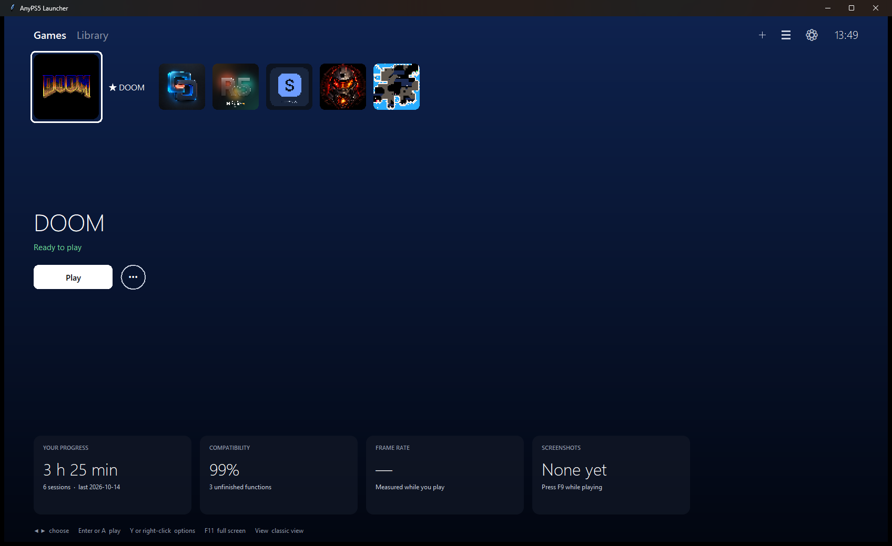
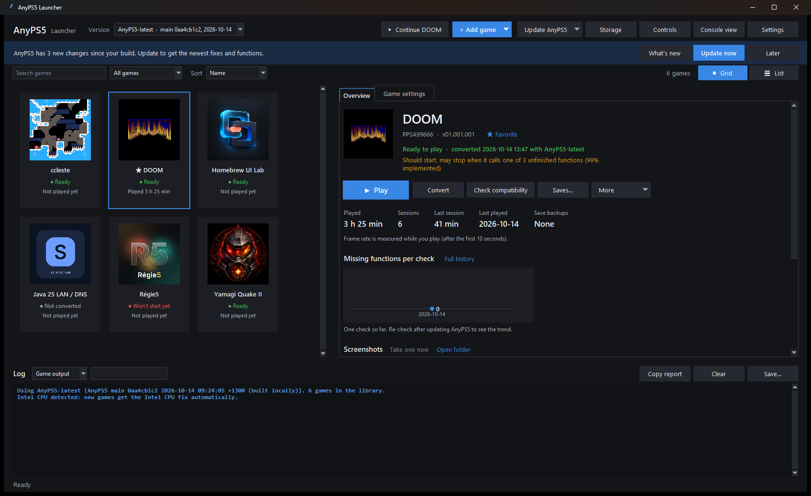

<div align="center">

# AnyPS5 Launcher

**A PS5-style home screen and game library for [AnyPS5](https://github.com/boykopovar/AnyPS5) on Windows.**
Add a game, convert it, and play it in one click. AnyPS5 updates come straight from the original repository.

[](#getting-started)
[](https://www.python.org/downloads/windows/)
[](#getting-started)
[](LICENSE)
[](https://github.com/boykopovar/AnyPS5)



</div>

> **Unofficial.** This launcher is a community front end. It is not part of AnyPS5 and not affiliated with the AnyPS5 project or Sony Interactive Entertainment. It contains no games, firmware or Sony files.

## Always on the newest AnyPS5, straight from the original repo

The launcher does not ship its own copy of AnyPS5. Every AnyPS5 it installs comes **directly from the official repository, [boykopovar/AnyPS5](https://github.com/boykopovar/AnyPS5)**, so new fixes reach you as soon as they land there:

- **Update AnyPS5 > Download latest official release** downloads the newest release from the official GitHub releases. No build tools are needed.
- **Update AnyPS5 > Build latest from source** pulls the newest `main` of your clone of the official repository, builds it, and swaps it in. If you changed the source yourself, your edits are carried over. If they clash with the new code, it offers to build the official code and keeps your edits safe in `git stash`.
- **Banner and notifications:** at start and every 24 hours it checks the official repository. When new changes exist, it shows a banner like *"AnyPS5 has 3 new changes since your build"* with **Update now**, and sends a Windows notification.
- **What's new in AnyPS5** lists those upstream changes grouped into New, Fixed and Faster, with links to their pull requests. Changes that touch a function one of *your* games still needs are listed first.
- **After an update** it offers to re-convert the games the update made outdated, and tells you which missing functions became available.

## Two ways to browse

| PS5-style home | Classic library |
|---|---|
|  |  |
| Big tiles and a hero area for the focused game. Play is front and center, with cards for playtime, compatibility, frame rate and screenshots. Works with the keyboard and with an Xbox-style controller. | Every detail in one place: cover grid or list, search, filters and sort. Each game shows its status, per-game settings, saves, playtime and compatibility history. |

Switch with **Library** / **Console view**. The launcher remembers which one you used last. The PS5-style view echoes the console's layout but uses no PlayStation logos, fonts or sounds.

## Features

- **One-click play.** Add a game folder and the launcher reads its title, ID and icon, converts it with the AnyPS5 relinker and runs a compatibility check. Game files are hard-linked, so there are no extra copies, and the original folder is never changed. Intel CPUs get the Intel fix automatically.
- **Compatibility check.** Before you play, it shows how many of the system functions a game needs AnyPS5 already has. The history across updates is kept, so you can see a game getting closer.
- **Scan a whole drive** for game folders and add them all at once.
- **Saves and playtime.** Automatic save backups before and after every session, with restore, zip export and import. Playtime and session history are tracked.
- **Frame rate.** An optional always-on-top FPS counter, plus average, lowest and highest frame rate per session.
- **Screenshots.** Press **F9** while playing; the newest ones show up as a gallery.
- **Controllers.** Live tester for Xbox-style controllers, the shared keyboard and mouse layout, and per-game layouts.
- **Shortcuts.** Desktop and Start-menu shortcuts per game with their own icons, **Continue \<last game\>**, and `--play <title id>` from the command line.
- **Clear logs.** Game output with plain-English hints for known failures, a "problems only" view, and **Copy report** for asking for help.
- **Discord status, free system fonts, storage cleanup, move to another PC,** light and dark themes.

The full tour is in **[docs/GUIDE.md](docs/GUIDE.md)**.

## Getting started

**You need:** Windows 10 or 11 (64-bit) and [Python 3.12 or newer](https://www.python.org/downloads/windows/). Nothing else is installed from pip.

1. **Download the launcher:** **Code > Download ZIP** above, or
   ```powershell
   git clone https://github.com/ahmad3a4/AnyPS5-Launcher
   ```
2. **Start it:** double-click **`Start AnyPS5 Launcher.cmd`**.
3. **Get AnyPS5:** **Update AnyPS5 > Download latest official release**. It is installed next to the launcher, inside this folder.
4. **Add a game:** **+ Add game** and pick the folder with `eboot.bin` and `sce_sys`. Then press **Play**.

### Optional: build AnyPS5 from source for the newest fixes

Releases come out now and then; `main` of the official repository changes many times a day. To follow it:

1. Install [Git for Windows](https://git-scm.com/download/win), plus [WinLibs GCC 15.2.0 (UCRT, posix-seh, release `15.2.0posix-14.0.0-ucrt-r7`)](https://winlibs.com/), the only toolchain AnyPS5 supports on Windows, unpacked to `C:\winlibs`.
2. Clone the official repository:
   ```powershell
   git clone https://github.com/boykopovar/AnyPS5 C:\dev\AnyPS5
   git -C C:\dev\AnyPS5 submodule update --init --recursive
   ```
3. In the launcher, choose **Update AnyPS5 > Build latest from source**. The paths can be changed in **Settings**. The first build takes a while; later updates rebuild only what changed.

See AnyPS5's own [build instructions](https://github.com/boykopovar/AnyPS5/blob/main/docs/dev/BUILD.md) for details.

## What it does not do

- **No piracy.** No games, keys, firmware or Sony files are included or downloaded. Use games you dumped from your own console, or homebrew. Encrypted retail executables are refused.
- **It does not emulate anything itself.** All the emulation work is AnyPS5's. If a game does not run, the launcher shows why. Fixes for that belong in [AnyPS5](https://github.com/boykopovar/AnyPS5).

## Where things live

| Path | Contents |
|---|---|
| `AnyPS5-latest/`, `AnyPS5-v*/` | AnyPS5 builds and releases installed by the launcher |
| `launcher/data/` | Your library, settings, controls, fonts and save backups |
| `<game folder>-anyps5/` | The converted game, with its saves and shader cache |

Set `ANYPS5_LAUNCHER_DATA` to keep the data somewhere else.

## Contributing

Issues and pull requests are welcome. The launcher is plain Python and Tkinter with no third-party packages. Run the tests with:

```powershell
python -m unittest discover -s launcher\tests -v
```

If the launcher is useful to you, **a ⭐ helps other AnyPS5 users find it.**

## Credits

- **[AnyPS5](https://github.com/boykopovar/AnyPS5)** by boykopovar and its contributors (GPL-2.0) does all the real work: the relinker and the reimplemented PS5 system libraries.
- The screenshots show free homebrew: [DOOM](https://github.com/lowbit/ps5-doom), [Yamagi Quake II](https://github.com/blackbearreloaded/ps5-yamagi-quake2), [ccleste](https://github.com/darkxex/PS5_Celeste), [Homebrew UI Lab](https://github.com/blackbearreloaded/ps5-homebrew-ui), [Régie5](https://github.com/viviandsx/regie5) and [Java 25 LAN / DNS](https://github.com/mateo-cogeanu/ps5-java25-homebrew). Their statuses are real results from AnyPS5 `main` at the time.

## License

[MIT](LICENSE) © 2026 ahmad3a4. "PlayStation" and "PS5" are trademarks of Sony Interactive Entertainment Inc.
